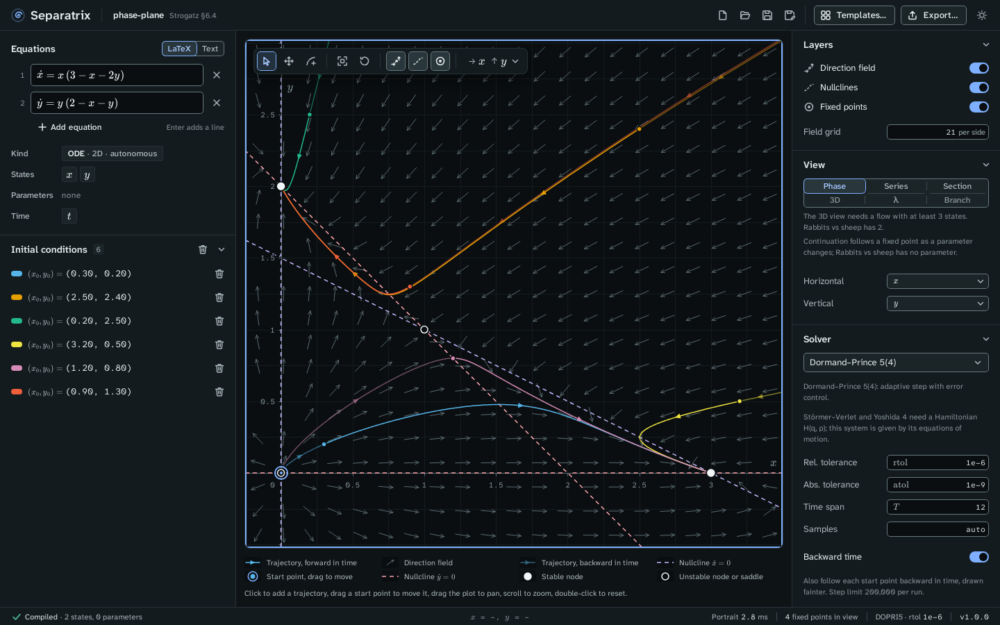
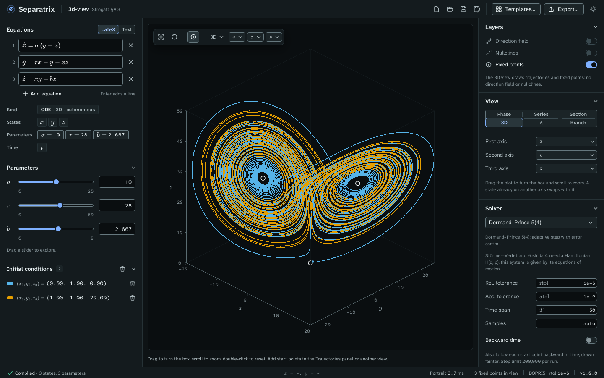
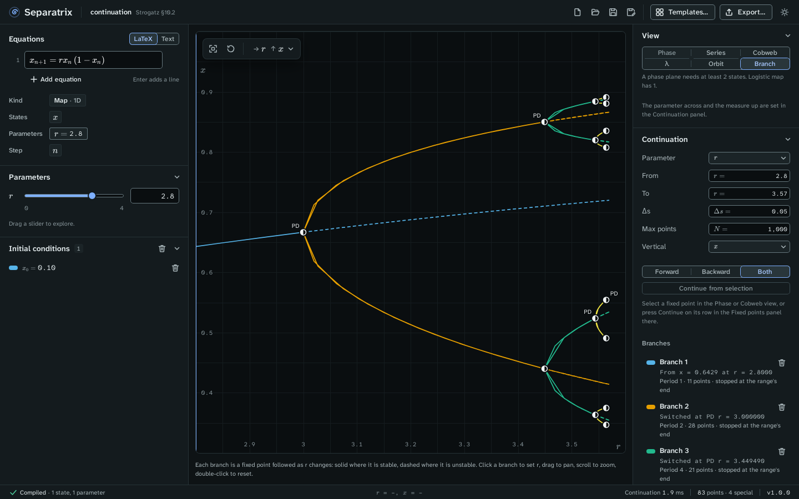

# Separatrix

Separatrix is a desktop app for exploring dynamical systems, made for students and professors of
mathematics, physics and the applied sciences. Type a system the way you write it on the board,
and see its phase portrait change as you drag a parameter. It runs on Windows, macOS and Linux, and
works offline.



## What it does

- **Phase planes and time series** of flows in any dimension, with the direction field, nullclines,
  and fixed points classified by their eigenvalues.
- **Cobweb plots** of one-dimensional maps such as the logistic map.
- **Poincaré sections** through a plane or once per forcing period, and return maps.
- **A 3D view** of any three states of a flow, which you can turn and zoom.
- **Lyapunov spectra** of flows and maps. For the Lorenz equations, λ₁ = 0.9051 ± 0.0013 against
  Sprott's 0.9056.
- **Orbit diagrams** of maps, with the period doublings r₁ … r₄ = 3.000000, 3.449490, 3.544090,
  3.564407 of the logistic map.
- **Continuation** of equilibria and cycles, with folds, Hopf points, branch points, flips and
  Neimark–Sacker points marked. Sel'kov's Hopf points come out at b = 0.346410 and 0.848528.
- **A gallery of 33 examples**: 31 from Strogatz's *Nonlinear Dynamics and Chaos* (2nd edition), each
  citing its section of the book, and two reference systems of two-parameter continuation.
- **Exports** to LaTeX (pgfplots figures, equations and tables), SVG, PNG and CSV, and project
  files you can email to a class.
- **Projector mode**, a light theme with larger type for the lecture hall.

| The Lorenz attractor in the 3D view | The logistic map's period-doubling cascade |
| --- | --- |
|  |  |

## Install

Download Separatrix from the [releases page](https://github.com/uncrayon/separatrix/releases/latest).
Each guide walks you through the download, the checksum and the first launch:

- [Install on Windows](docs/install/windows.md)
- [Install on macOS](docs/install/macos.md)
- [Install on Linux](docs/install/linux.md)

## Learn to use it

The [user guide](docs/guide/) starts with a ten-minute tutorial and has a page for every view.
Each view's page links an example project you can open.

## Build from source

You need Rust 1.90 or newer and Node 22. On Linux you also need the WebKitGTK and GTK development
packages:

```sh
sudo apt install libwebkit2gtk-4.1-dev libgtk-3-dev librsvg2-dev libayatana-appindicator3-dev
```

Run the app in development mode:

```sh
cd app
npm install
npm run tauri dev
```

Build the installers for your platform:

```sh
cd app
npx tauri build
```

The installers land in `target/release/bundle/`.

## Repository layout

| Path | What it holds |
| --- | --- |
| `crates/dyn-core` | The `VectorField` trait that every solver and analysis uses. |
| `crates/dyn-expr` | Equation parsing, inference of states and parameters, evaluation, and exact Jacobians. |
| `crates/dyn-solve` | Integrators, map iteration, events and Poincaré sections. |
| `crates/dyn-analysis` | Fixed points, nullclines, Lyapunov spectra, orbit diagrams and continuation. |
| `crates/export` | LaTeX, CSV and other exports, with no Tauri dependency. |
| `crates/project` | The `.sepx` project format. |
| `app/src-tauri` | The Tauri shell and its commands. |
| `app/src` | The React and TypeScript interface. |
| `docs/` | The user guide, the install guides, and the reference for the IPC, exports and the project format. |

## Contribute

[CONTRIBUTING.md](CONTRIBUTING.md) lists the checks every change must pass, including the three
numerical gates that hold Separatrix to Strogatz's results and to published values.

The previous Python version (v0.1.0, PyPI `equation-phase-portrait-tool`) is deprecated and lives
in git history. [CHANGELOG.md](CHANGELOG.md) lists every change.

## License

MIT
