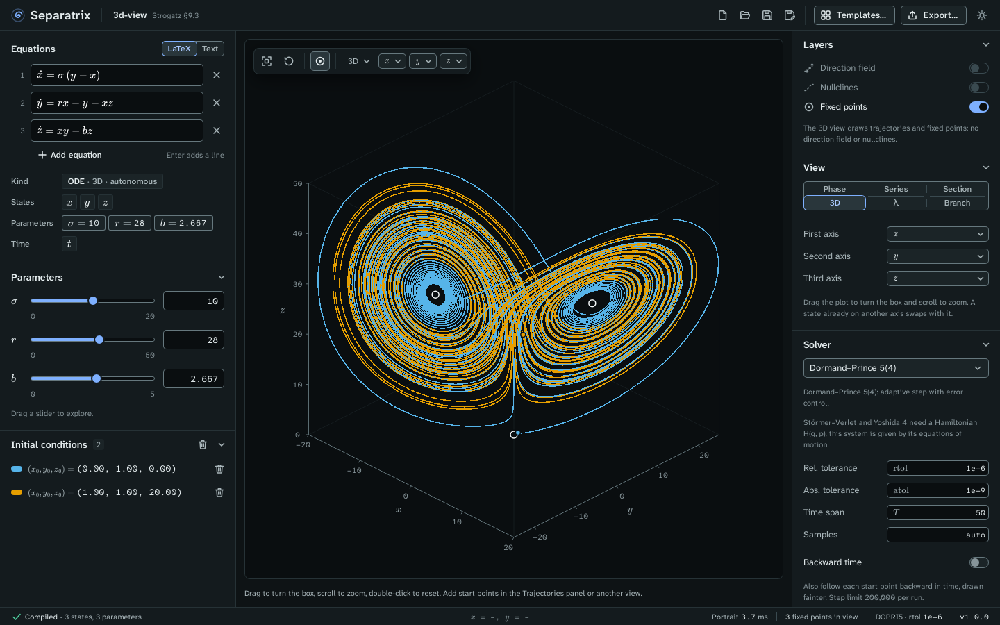

# 3D view

The 3D view draws trajectories of a flow against three of its states inside a box you can turn
and zoom (Strogatz chapter 9). Choose **3D** in the **View** panel. It is offered for a flow with
three states or more.

Example project: [3d-view.sepx](examples/3d-view.sepx), the Lorenz equations of Strogatz §9.3 at
σ = 10, r = 28 and b = 8/3, with two trajectories on the attractor and the three fixed points. They
are the origin, and C⁺ and C⁻ at the centers of the two wings.

## Turn and zoom

- Drag the plot to turn the box.
- Scroll to zoom.
- Double-click to go back to the starting camera.
- With the plot focused, the arrow keys turn the box by 5°, or 15° with Shift. Plus and minus zoom,
  and 0 resets the camera.

The camera is saved in the project file, so the box opens the way you left it.

## Choose the states

The **View** panel has **First axis**, **Second axis** and **Third axis** menus, and the plot's
toolbar has the same three menus. Choosing a state that is already on another axis swaps the two.

## Add trajectories

You can't click a point in three dimensions, so the 3D view has no click-to-add. Add start points
in the **Trajectories** panel, or switch to the phase plane, click there, and switch back. The
**Initial conditions** panel lists every start point with its three coordinates.

## What the view leaves out

The 3D view draws trajectories and fixed points only, with no direction field and no nullclines.
On a computer without WebGL, it draws the trajectories on a plain canvas and says so. They are
then redrawn when you stop dragging.

## Export

PNG and SVG show the box from your camera. The LaTeX figure is not available for the 3D view.
LaTeX equations, the fixed-point table and CSV work as in any other view. See
[Export figures and data](exports.md).
