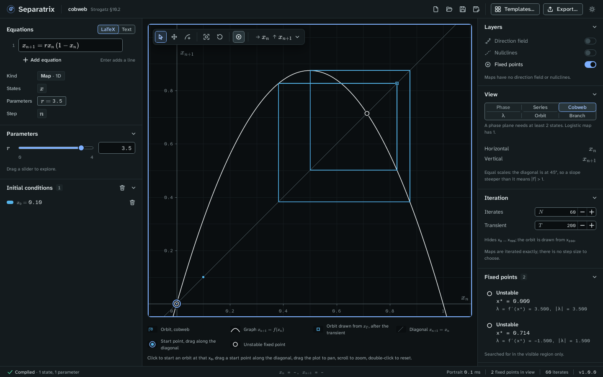

# Cobweb

The cobweb view draws the graph of a one-dimensional map x_{n+1} = f(x_n), the diagonal
x_{n+1} = x_n, and the staircase of each orbit between them (Strogatz §10.1). Choose **Cobweb** in
the **View** panel. It is offered only for a one-dimensional map that does not depend on `n`.

Example project: [cobweb.sepx](examples/cobweb.sepx), the logistic map x_{n+1} = r x_n (1 − x_n)
at r = 3.5, with a transient of 200 iterates hidden. What remains is the attracting 4-cycle,
since r = 3.5 lies between the period doublings r₂ = 3.449490 and r₃ = 3.544090.

## Read the plot

| Mark | Meaning |
| --- | --- |
| Curve | The graph of f. |
| Thin diagonal | x_{n+1} = x_n. Fixed points lie where the graph crosses it. |
| Staircase | An orbit, going up to the graph, across to the diagonal, and up again. |
| Square on the diagonal | The first iterate drawn after the transient, x_T. |
| Ringed dot | The start point x₀. Drag it along the diagonal. |
| Filled or open circle | A stable or unstable fixed point. |

The axes have equal scales, so the diagonal is at 45°. Where the graph is steeper than the
diagonal, |f′| > 1.

## Start and move orbits

- Click the plot to start an orbit at that x₀.
- Drag a start point along the diagonal.
- With the plot focused, the arrow keys move a cursor along the diagonal, and Enter starts an orbit
  there.

## Set the iterates

The **Iteration** panel sets:

- **Iterates** N, the number of steps drawn.
- **Transient** T, the number of steps hidden first. With T = 200, the orbit is drawn from x₂₀₀.

A map is iterated exactly, so there is no step size to choose.

## Read the fixed points

The **Fixed points** panel lists each fixed point x* with its multiplier λ = f′(x*) and |λ|. A
fixed point is stable when |λ| < 1. At a kink of f, where f′(x*) does not exist, the panel says so.

To see the same map as r changes, switch to the [orbit diagram](orbit-diagram.md). To follow one
fixed point and its period doublings, switch to [continuation](continuation.md).
