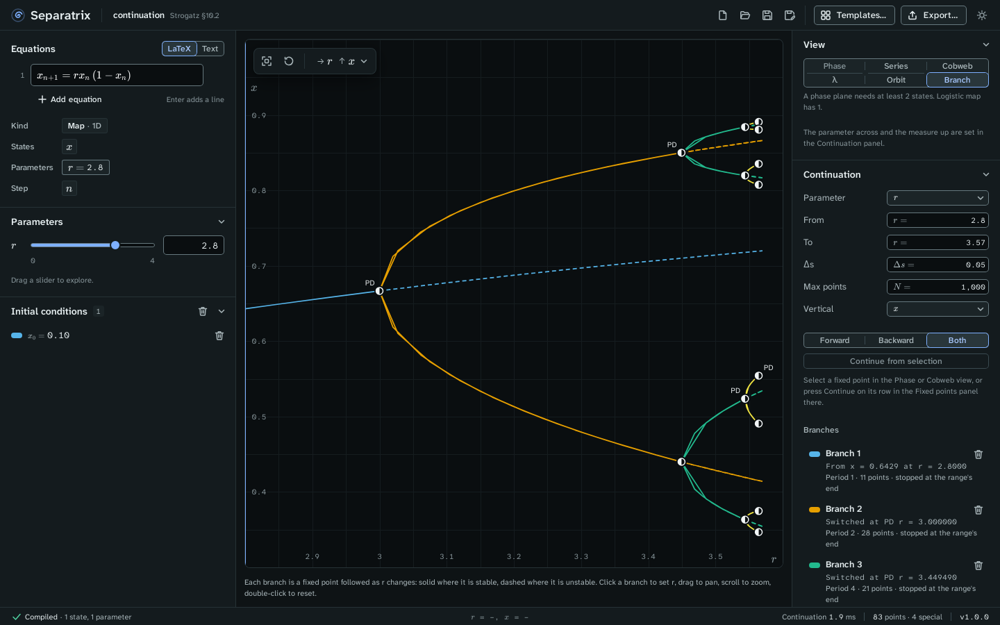

# Continuation

The Branch view follows a fixed point, of a flow or of a map, as one parameter changes, and marks
the bifurcations it passes. Choose **Branch** in the **View** panel. It is offered for a system
with a parameter whose equations don't contain `t` or `n`.

Example project: [continuation.sepx](examples/continuation.sepx), the logistic map for r from 2.8
to 3.57. Branch 1 is the fixed point. Branches 2 and 3 were switched onto at its flips, and follow
the 2-cycle and the 4-cycle.

## Read the plot

The parameter runs across and a state, or ‖x‖, runs up. Each branch has its own color.

- A solid line is stable, and a dashed line is unstable.
- Every point of a cycle is drawn, so a 2-cycle is two curves.
- Each special point is a fixed-point glyph with a label:

| Label | Bifurcation | Found on |
| --- | --- | --- |
| LP | Fold, or limit point | Flows and maps |
| H | Hopf point | Flows |
| BP | Branch point, where two branches cross | Flows and maps |
| PD | Flip, or period doubling | Maps |
| NS | Neimark–Sacker point | Maps |

Click a branch to set the parameter to that point. The slider and the other views follow.

## Start a branch

When you switch to **Branch**, a branch starts from the selected fixed point, or from every fixed
point in view when none is selected. To add a branch from one fixed point, do one of these:

- In the **Phase** or **Cobweb** view, click the fixed point's row in the **Fixed points** panel and
  click **Continue**. Separatrix switches to the Branch view and follows it.
- Select a fixed point in the **Phase** or **Cobweb** view, switch to **Branch**, and click
  **Continue from selection**.

## Set the continuation

| Field | Meaning |
| --- | --- |
| **Parameter** | The parameter that changes. |
| **From**, **To** | The range a branch may cover. |
| **Δs** | The first step along the branch, in arclength. Steps grow to twice it where the branch is straight. |
| **Max points** | The most points of a branch in each direction. |
| **Vertical** | The state on the vertical axis, or ‖x‖. |
| **Forward**, **Backward**, **Both** | Follow the branch with the parameter increasing, decreasing, or both ways. |

## Read the branches and the special points

The **Branches** list gives each branch's start, its period, its number of points, and why each
end stopped. An end stops at the range's end, at **Max points**, or where a step gets too small to
go on. The bin icon removes a branch.

The **Special points** list gives each bifurcation once, in increasing parameter, with the state
and, at a Hopf point, the frequency ω and the first Lyapunov coefficient ℓ₁. A negative ℓ₁ means a
supercritical Hopf point, and a positive one a subcritical point. Click a row to set the parameter
there.

At a BP or PD row, **Switch branch** follows the second branch both ways. At a flip of the logistic
map, that branch is the cycle of twice the period. A point you have already switched at reads
"Followed as Branch k" instead.

## Check the numbers

The continuation gate checks the same command against closed-form values. Two examples:

- Sel'kov's glycolysis model (Strogatz §7.3) at a = 0.08 has Hopf points at b = 0.346410 and
  b = 0.848528, which are √0.12 and √0.72, with ω = 0.447214 and 0.894427.
- Switching at each flip of the logistic map gives r₁ … r₄ = 3.000000, 3.449490, 3.544090,
  3.564407 in three clicks of **Switch branch**.

## Export

The export dialog writes the branch plot as a pgfplots figure, the special points as a booktabs
table with siunitx numbers, and the branches as CSV. See [Export figures and data](exports.md).
