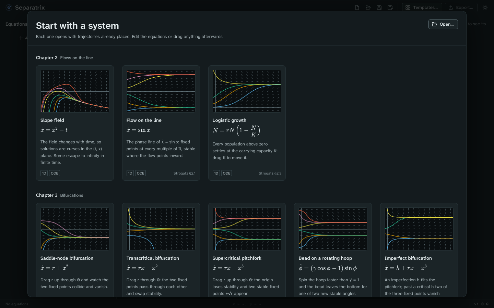

# Getting started

In this tutorial you open the Van der Pol oscillator, add a trajectory, watch the limit cycle
change as you drag a parameter, and then save and export your work. It takes about ten minutes.
If Separatrix is not installed yet, follow the install guide for
[Windows](../install/windows.md), [macOS](../install/macos.md) or [Linux](../install/linux.md).

## Open an example

Start Separatrix. The template gallery opens with 31 examples from Strogatz's *Nonlinear Dynamics
and Chaos*, grouped by chapter. Each card names the section of the book it comes from.

1. Scroll to **Chapter 7**.
2. Click **Van der Pol oscillator**.

The gallery closes and the phase plane opens. You see three areas:

- The left panel holds the **Equations**, the **Parameters** and the **Initial conditions**.
- The middle holds the plot, with a toolbar in its top left corner and a legend under it.
- The right panel, the inspector, holds **Layers**, **View**, **Solver**, **Fixed points** and
  **Trajectories**.

The status bar at the bottom says whether the equations compiled, where the pointer is in plot
coordinates, how long the last computation took, and the app's version.

## Add a trajectory

1. Click anywhere on the plot. A new trajectory starts at that point and winds onto the limit
   cycle.
2. Drag the start point, the ringed dot at the start of the curve. The trajectory follows the
   pointer.
3. Scroll over the plot to zoom. Drag empty space to pan. Double-click to go back to the starting
   view.

The open circle at the origin is the fixed point. It is open because it is unstable. The
**Fixed points** panel lists it with its eigenvalues.

## Drag a parameter

In the **Parameters** panel, drag the μ slider. Every trajectory is recomputed as you drag. As μ
grows, the limit cycle changes from a near circle into the relaxation oscillation of Strogatz
§7.5.

To type an exact value, click the number box beside the slider. To change the slider's range,
click the minimum or the maximum under it.

## Look at the same system over time

In the **View** panel, click **Series**. The plot now shows x against t for each trajectory. Click
**Phase** to go back. [Time series](time-series.md) explains the view.

## Save and export

1. Press Ctrl+S (⌘S on a Mac) and choose a file name. Separatrix saves a `.sepx` project file
   that holds the equations, parameters, start points and view. The top bar now shows its name.
2. Press Ctrl+E (⌘E on a Mac). The export dialog opens with **LaTeX** and **Figure** selected.
3. Click **Copy LaTeX** and paste the result into your document. It needs the `pgfplots`
   package, which the first lines of the snippet name.

## Next steps

- [Enter your own equations](equations.md).
- Try the other views: [phase plane](phase-plane.md), [cobweb](cobweb.md),
  [3D view](3d-view.md), [Poincaré section](poincare-section.md), [Lyapunov spectrum](lyapunov.md),
  [orbit diagram](orbit-diagram.md) and [continuation](continuation.md).
- Before a lecture, switch on [projector mode](projector-mode.md).
- To open the gallery again, click **Templates…** at the top of the window.
