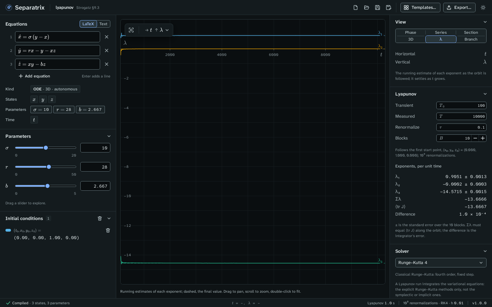

# Lyapunov spectrum

The Lyapunov view measures every Lyapunov exponent of a flow or a map along one orbit, and plots
the running estimate of each exponent against t or n (Strogatz §9.3 and §10.5). Choose **λ** in
the **View** panel. It is offered for every system.

Example project: [lyapunov.sepx](examples/lyapunov.sepx), the Lorenz equations at σ = 10, r = 28,
b = 8/3, integrated with Runge–Kutta 4 at h = 0.01 over T = 10⁴ after a transient of 100, with a
renormalization every τ = 0.1. The **Lyapunov** panel reads:

| Exponent | Separatrix | Sprott's published value |
| --- | --- | --- |
| λ₁ | 0.9051 ± 0.0013 | 0.9056 |
| λ₂ | −0.0002 ± 0.0003 | 0 |
| λ₃ | −14.5715 ± 0.0015 | −14.5723 |

## Read the panel

- **Exponents, per unit time** lists each exponent with ±, the standard error over the blocks.
  A map's exponents are per iterate.
- **Σλ** is the sum of the exponents. For a flow it must equal ⟨tr J⟩, the mean trace of the
  Jacobian along the orbit. **Difference** shows the gap, which is the integrator's error. For
  Lorenz, Σλ = −(σ + 1 + b) = −41/3, and at h = 0.01 the difference is 1.0 × 10⁻⁴.
- The plot shows the running estimates. Each settles as t grows. A dashed line marks each final
  value.

A positive λ₁ means that nearby orbits separate exponentially, so the Lorenz orbit is chaotic.
A flow whose orbit doesn't settle on a fixed point has one exponent equal to 0, for the direction
along the orbit.

## Set the run

| Field | Meaning |
| --- | --- |
| **Transient** T₀ | Time, or iterates for a map, run before measuring. |
| **Measured** T | Time or iterates measured after the transient. |
| **Renormalize** τ | Time between Gram–Schmidt renormalizations. For a map, the iterates between them. |
| **Blocks** B | The run is split into this many blocks, and ± is the standard error of their estimates. |

The run follows the selected start point, or the first one. It uses the method in the **Solver**
panel, which must be an explicit method: Dormand–Prince 5(4), Runge–Kutta 4, Heun or Euler. The
symplectic and implicit methods are greyed out in this view. A run is limited to 10⁷
renormalizations.

## Check other systems

The chaos gate checks the same command on two maps. The Hénon map at a = 1.4, b = 0.3 gives
λ₁ = 0.4194 and λ₂ = −1.6234 (published: 0.41922 and −1.62319), with Σλ = ln 0.3 = −1.2039728.
The logistic map at r = 4 gives λ = 0.69315, which is ln 2.

## Export

The export dialog writes the spectrum as a LaTeX table with siunitx uncertainties, the running
estimates as CSV, and the plot as PNG or SVG. See [Export figures and data](exports.md).
