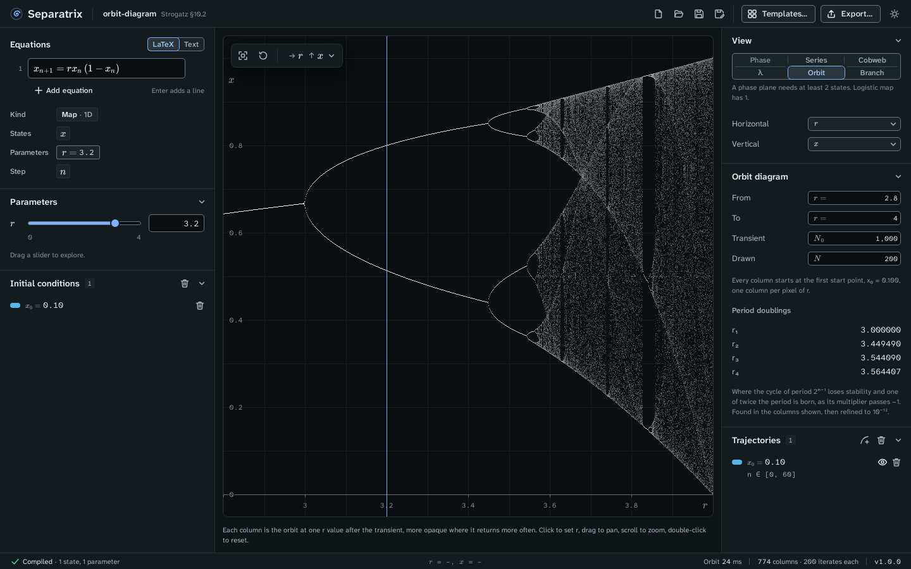

# Orbit diagram

The orbit diagram iterates a map at many values of one parameter and draws, above each value, the
iterates left after a transient (Strogatz §10.2, Figure 10.2.7). It shows the period-doubling
route to chaos at a glance. Choose **Orbit** in the **View** panel. It is offered for a map with a
parameter.

Example project: [orbit-diagram.sepx](examples/orbit-diagram.sepx), the logistic map for r from 2.8
to 4, with 1,000 transient iterates and 200 drawn in each column.

## Read the plot

Each column of pixels is one value of the parameter. Every column starts at the first start point,
runs the transient, and then plots the next iterates. A column is more opaque where the orbit
returns more often. A stable fixed point shows as one curve, a 2-cycle as two, and chaos as a
filled band. The vertical line marks the parameter's current value.

Click a column to set the parameter to that column's value. The other views and the parameter's
slider follow.

## Read the period doublings

For a one-dimensional map, the **Orbit diagram** panel lists the period doublings it finds in the
columns shown. Each is where the cycle of period 2ⁿ⁻¹ loses stability and the cycle of twice the
period is born, as its multiplier passes −1. The panel refines each to 10⁻¹². For the logistic map:

| | Separatrix | Exact or published |
| --- | --- | --- |
| r₁ | 3.000000 | 3 |
| r₂ | 3.449490 | 1 + √6 |
| r₃ | 3.544090 | 3.544090360 |
| r₄ | 3.564407 | 3.564407266 |

The chaos gate checks these to 10⁻⁶. The ratio (r₃ − r₂)/(r₄ − r₃) = 4.656 already approaches
Feigenbaum's δ = 4.669.

## Set the diagram

| Field | Meaning |
| --- | --- |
| **From**, **To** | The parameter's range across the plot. |
| **Transient** N₀ | Iterates run before plotting, up to 100,000. |
| **Drawn** N | Iterates plotted in each column, from 1 to 976. |

Zoom into a window, such as r from 3.82 to 3.86, to see the period-3 window open with a
saddle-node bifurcation (Strogatz §10.4).

## Export

The LaTeX figure draws the diagram with pgfplots, as up to 5,000 dots. Above that, **Save…** writes
a density image and **Copy LaTeX** draws fewer dots. CSV writes one row per kept iterate. See
[Export figures and data](exports.md).
