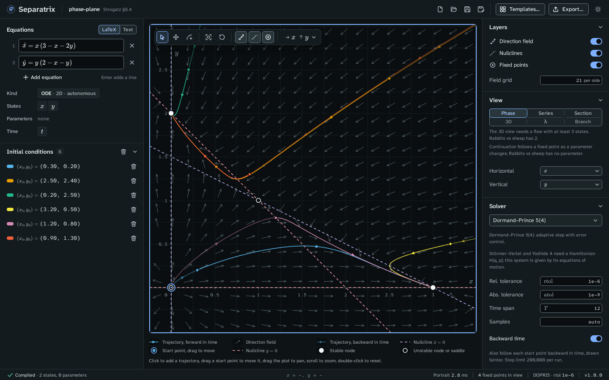

# Phase plane

The phase plane draws trajectories of a system with two or more states against two of them, with
the direction field, the nullclines and the fixed points. Choose **Phase** in the **View** panel.

Example project: [phase-plane.sepx](examples/phase-plane.sepx), the rabbits-versus-sheep model of
Strogatz §6.4. The fixed point at (0, 0) is unstable, (0, 2) and (3, 0) are stable nodes, and
(1, 1) is a saddle, as the Strogatz gate checks.

## Read the plot

| Mark | Meaning |
| --- | --- |
| Solid line with arrows | A trajectory, forward in time. |
| Fainter line | The same trajectory backward in time, when **Backward time** is on in the **Solver** panel. |
| Ringed dot | A start point. Drag it to move the trajectory. |
| Short arrows | The direction field, with arrows of normalized length. |
| Dashed lines | The nullclines, where ẋ = 0 or ẏ = 0. Each has its own color, named in the legend. |
| Filled circle | A stable fixed point. |
| Open circle | An unstable fixed point. |

The legend under the plot names every mark that is on screen. The status bar shows the pointer's
coordinates and how many fixed points are in view.

## Work with trajectories

- Click the plot to add a trajectory that starts there.
- Drag a start point to move it.
- Click a trajectory to select it. The **Trajectories** panel shows its start state, end state and
  the solver's step counts. Press Delete to remove it, or Escape to deselect it.
- Click the eye icon in the **Trajectories** panel to hide a trajectory without deleting it.

The toolbar in the top left corner of the plot has three tools: **Select** drags start points,
**Pan** drags the plot, and **Add trajectory** adds a start point on each click. Its other buttons
are **Zoom to fit** the trajectories, **Reset view**, and switches for the direction field, the
nullclines and the fixed points.

## Read the fixed points

The **Fixed points** panel lists every fixed point in view with its type (stable node, saddle,
unstable spiral, center and so on) and its eigenvalues. Click a row or a fixed point on the plot to
select it. **Show eigenvectors** draws a line along each real eigenvector, with arrows that point
in for a stable direction and out for an unstable one.

## Choose the axes

A system with more than two states shows two of them at a time. Choose the states in the
**Horizontal** and **Vertical** menus of the **View** panel, or in the axes menu at the right end
of the plot's toolbar. The other states are held at the values under **Field slice** for the
direction field and the nullclines. Trajectories always use every state.

The field of a nonautonomous system, one with `t` on the right-hand side, changes with time. For
such a system, the field is drawn at **Field at time** under **Field slice**, and fixed points
are not searched.

## Change the layers

The **Layers** panel switches the direction field, the nullclines and the fixed points on and off.
**Field grid** sets the number of arrows per side, from 2 to 200.
