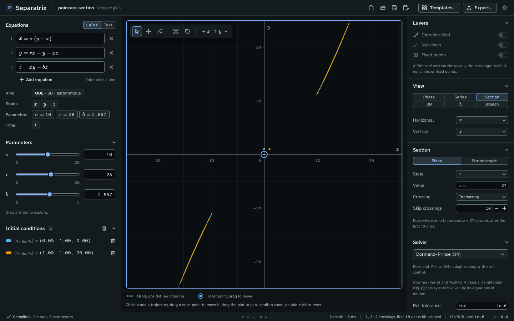

# Poincaré section

A Poincaré section shows where a flow's orbits cross a plane, one dot per crossing (Strogatz §8.7).
Choose **Section** in the **View** panel. It is offered for any flow.

Example project: [poincare-section.sepx](examples/poincare-section.sepx), the Lorenz equations cut
by the plane z = 27, counting the crossings where z increases and skipping the first 10 of each
orbit. The dots lie along two short curves, one for each wing of the attractor.

## Choose the kind of section

The **Section** panel has two kinds.

- **Plane** holds one state at a value. Choose the **State**, its **Value**, and the **Crossing**
  direction: **Increasing**, **Decreasing** or **Both**. A plane needs a flow with at least two
  states.
- **Stroboscopic** samples the state once per forcing period, at t = phase + k·period for
  k = 0, 1, 2 and so on. Use it for a forced oscillator, whose equations contain `t`. Set the
  **Period** and the **Phase**.

**Skip crossings** hides the first crossings of each orbit, so the attractor stands out from the
transient. The status bar counts the crossings drawn.

## Plot a return map

To plot the return map x_k → x_{k+1}, choose the same state on both axes. The vertical axis then
shows the next crossing, x_{k+1}. A fixed point of the return map is a closed orbit of the flow.

The gallery's forced oscillator (Strogatz §8.7) opens as a stroboscopic return map. Its Poincaré
map has the fixed point x* = −A/2, and the Strogatz gate measures −0.500000 at A = 1.

## Add orbits

Click a plane section to start an orbit at that point of the plane. On a stroboscopic section,
the click starts an orbit at the section's phase. A return map takes no clicks, so add its orbits
in another view. A section draws no direction field, nullclines or fixed points.

To see the full orbits, switch to the [3D view](3d-view.md) or the [phase plane](phase-plane.md).
