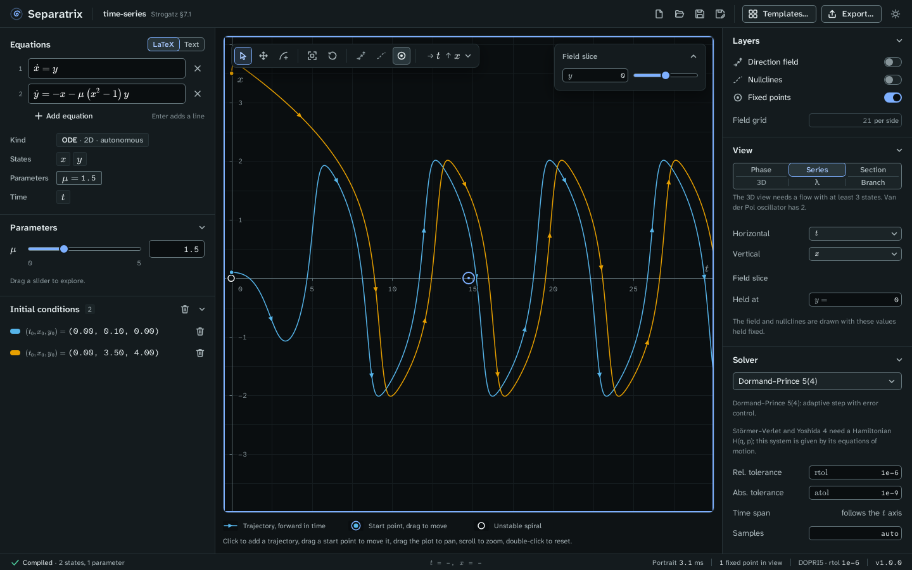

# Time series

The time series view plots a state against time, `t` for a flow or `n` for a map, for every
trajectory. Choose **Series** in the **View** panel.

Example project: [time-series.sepx](examples/time-series.sepx), the Van der Pol oscillator of
Strogatz §7.1 at μ = 1.5. Both trajectories settle onto the same limit cycle, so after a few
periods the two curves differ only by a shift in time.

## What the view shows

**Series** puts time across and the first state up. To plot another state, choose it in the
**Vertical** menu of the **View** panel or in the axes menu of the plot's toolbar. Either axis can
hold time, so you can also put time up and a state across.

In a time series, the time axis sets how far each trajectory runs. The **Solver** panel's **Time
span** reads "follows the t axis", because the trajectories cover exactly the visible time window.
Pan or zoom along t to see more of them.

A one-dimensional flow such as ẋ = sin x (Strogatz §2.1) opens as a time series with its slope
field, because a phase plane needs at least two states. The gallery's chapter 2, 3 and 4
examples open this way.

## Measure a period

Hover over the plot to read t and x in the status bar. For a sharper number, export the
trajectory as CSV ([Export figures and data](exports.md)) and measure the period there. For
comparison, the Strogatz gate measures the Van der Pol limit cycle at μ = 1 with a period of
T = 6.663286, against the book's 6.663287.

## Mouse and keys

Click to add a trajectory, drag a start point to move it, drag the plot to pan, scroll to zoom,
and double-click to reset. The keys are those of the phase plane, listed in
[Keyboard shortcuts](keyboard-shortcuts.md).
