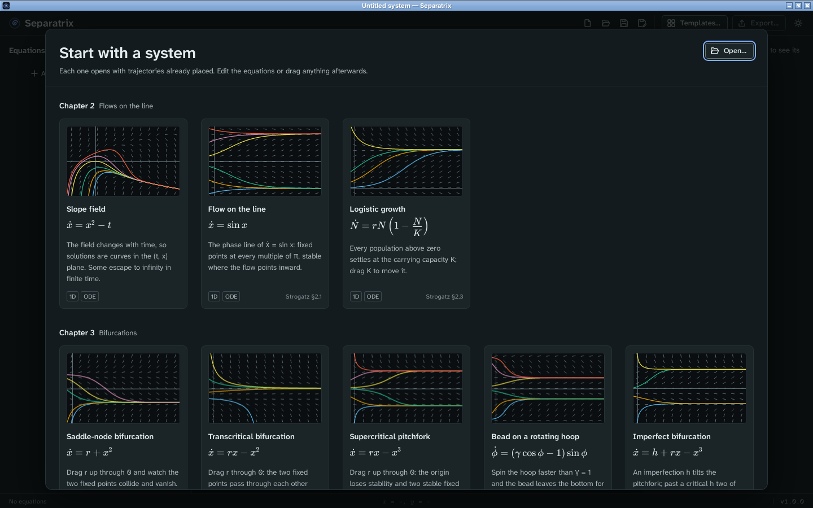
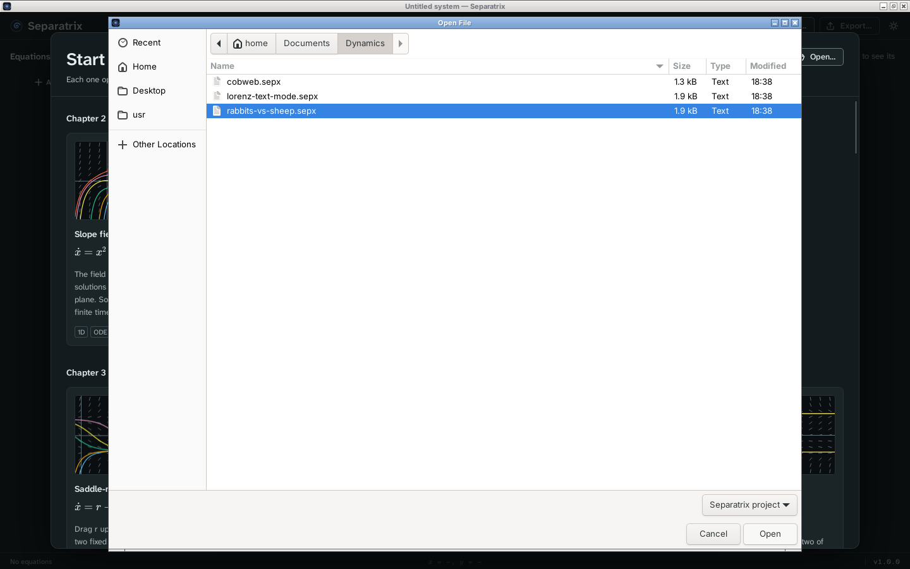
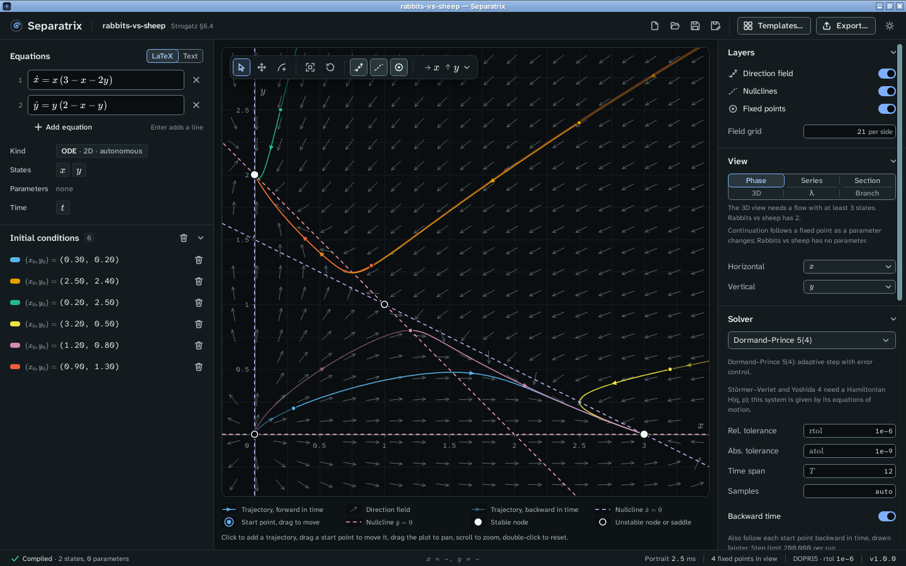

# Install Separatrix on Linux

This guide takes you from the download to your first project. You need a 64-bit Intel or AMD PC
with Ubuntu 22.04 or newer, or another distribution from 2022 or later. Separatrix needs no
internet connection after you install it.

## Choose a file

Go to the [Separatrix releases page](https://github.com/uncrayon/slope-field-vizualiser/releases/latest)
and look under **Assets**. Linux has three files. Pick one.

| File | Use it when |
| --- | --- |
| `Separatrix_1.0.0_linux_x86_64.AppImage` | You want one file that runs without installing anything. It works on most distributions and can update itself. |
| `Separatrix_1.0.0_linux_amd64.deb` | You use Ubuntu, Debian, Linux Mint or Pop!_OS and want Separatrix in your app menu. |
| `Separatrix_1.0.0_linux_x86_64.rpm` | You use Fedora, openSUSE or another RPM distribution and want Separatrix in your app menu. |

Download `SHA256SUMS.txt` too, and save it in the same folder as your file. The names on this page
are for version 1.0.0. A newer release has its own number in each name.

## Check the download

`SHA256SUMS.txt` lists the SHA-256 checksum of every file in the release. If your file's checksum
matches, the download is complete and is the file that was published.

1. Open a terminal in the folder that holds the download, usually `~/Downloads`:

   ```sh
   cd ~/Downloads
   ```

2. Run this command:

   ```sh
   sha256sum -c SHA256SUMS.txt --ignore-missing
   ```

3. Check that the line for your file ends in `OK`, for example
   `Separatrix_1.0.0_linux_x86_64.AppImage: OK`.

If the line ends in `FAILED`, delete the file and download it again. Do not open a file that fails
the check.

## Install it

Follow the section for the file you chose.

### AppImage

1. Make the file executable:

   ```sh
   chmod +x Separatrix_1.0.0_linux_x86_64.AppImage
   ```

   You can do the same in the Files app instead. Right-click the file, click **Properties**, and
   turn on **Executable as Program** (on Ubuntu 22.04, open the **Permissions** tab and select
   **Allow executing file as program**).

2. Run it:

   ```sh
   ./Separatrix_1.0.0_linux_x86_64.AppImage
   ```

   You can also double-click it in the Files app.

The AppImage needs FUSE, which most desktop installs already have. You do not need `libfuse2` or
`libfuse2t64`. If nothing opens and the terminal says `No suitable fusermount binary found`,
install FUSE and run the file again:

- On Ubuntu or Debian: `sudo apt install fuse3`
- On Fedora: `sudo dnf install fuse3`

If you cannot install packages, run the AppImage this way instead. It unpacks itself to a
temporary folder each time, so it starts more slowly.

```sh
./Separatrix_1.0.0_linux_x86_64.AppImage --appimage-extract-and-run
```

Keep the AppImage somewhere permanent, such as `~/Applications`, before you start using it. The
updater replaces the file in place.

### Debian or Ubuntu package (.deb)

Run this command in the folder that holds the file, and type your password when asked:

```sh
sudo apt install ./Separatrix_1.0.0_linux_amd64.deb
```

The `./` matters. Without it, `apt` looks for a package called that name online instead of using
your file. `apt` also installs the WebKitGTK libraries that Separatrix needs, if they are missing.

### Fedora or openSUSE package (.rpm)

On Fedora, run this command in the folder that holds the file, and type your password when asked:

```sh
sudo dnf install ./Separatrix_1.0.0_linux_x86_64.rpm
```

On openSUSE, use `sudo zypper install ./Separatrix_1.0.0_linux_x86_64.rpm` instead.

## Start Separatrix for the first time

If you installed the .deb or the .rpm, open your app menu and click **Separatrix**. From a terminal,
run `separatrix`. If you use the AppImage, run the file as in [the AppImage section](#appimage).

Separatrix opens on a gallery of example systems from Strogatz's *Nonlinear Dynamics and Chaos*.
Click any card to start from that system.



## Open a project

Separatrix saves projects as `.sepx` files. You can open one in three ways:

- Click **Open…** at the top right of the gallery, or press **Ctrl+O** at any time, then choose the
  file.
- Drag a `.sepx` file from the Files app onto the Separatrix window.
- If you installed the .deb or the .rpm, double-click a `.sepx` file in the Files app.



The project opens with its equations, trajectories and view as they were saved. The window title
shows the file name.



The gallery also lists the projects you opened most recently under **Recent**. Click one to open
it again.

## Update Separatrix

The version you have is at the bottom right of the window.


Separatrix checks for a new version after it starts. When one exists, the status bar shows
**Update available** beside the version. Click the version, then click **Install and restart**. You
can click the version at any time to check by hand. If you have unsaved changes, Separatrix asks
whether to save them first.

- **AppImage.** The update replaces the file in place.
- **.deb or .rpm.** Separatrix updates the installed package, so it asks for your password, as the
  first install did. You can also download the new file from the releases page, check it, and
  install it with the same command you used the first time.

Your projects and recent files stay where they are.

## Uninstall Separatrix

Follow the line for the file you installed:

- AppImage: delete the `.AppImage` file.
- .deb: run `sudo apt remove separatrix`.
- .rpm: run `sudo dnf remove separatrix`, or `sudo zypper remove separatrix` on openSUSE.

Uninstalling keeps your `.sepx` projects. To also delete the list of recent projects, delete the
folder `~/.config/io.github.uncrayon.separatrix`.
